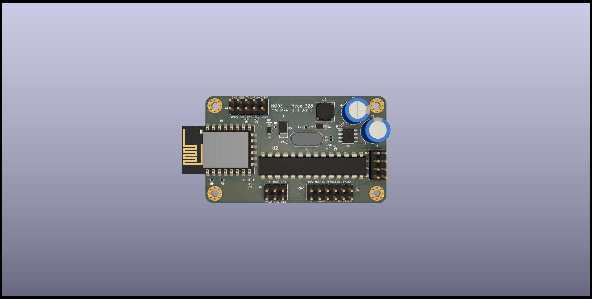
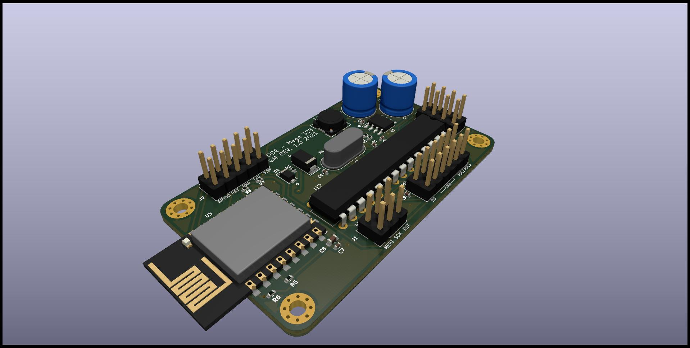

# Wifi-ATmega328

A compact embedded board that combines an ESP8266 Wi-Fi module with an ATmega328P microcontroller for projects that need low-cost wireless connectivity and simple MCU control.

## Overview

This project provides a custom PCB designed for applications where an ATmega328P handles the logic and an ESP8266 provides Wi-Fi communication. The design is intended for embedded systems, IoT prototypes, sensor gateways, and small control boards that need a lightweight microcontroller plus wireless connectivity.

The board includes:

- ESP8266 Wi-Fi module
- ATmega328P microcontroller
- power regulation from a 12V / 5V input to the required logic voltages
- ICSP programming interface for the ATmega328P
- KiCad hardware design files for modification and reproduction

## Hardware architecture

The board is built around two processing elements:

- ATmega328P: used for application logic, sensor acquisition, timers, and control tasks
- ESP8266: used for Wi-Fi communication, network connectivity, and possible ESP-Now communication

The supplied power stage converts the board supply into the voltage levels required by the modules. A dedicated ICSP connector allows the ATmega328P to be programmed directly without removing it from the board.

The hardware project is available in the [hardware](./hardware) folder and includes the KiCad schematic and PCB files.

## Software options

The ESP8266 can be used with the AT command firmware, enabling communication with the ATmega328P through serial interfaces. In this setup, the MCU can delegate Wi-Fi tasks to the ESP8266 while continuing to handle local logic.

Recommended software paths:

- [WiFiEspAT library](https://github.com/jandrassy/WiFiEspAT.git) for AT firmware-based Wi-Fi communication
- [WiFiESPNow library](https://github.com/yoursunny/WifiEspNow) for ESP-Now communication scenarios

This makes the board suitable for both classic serial-controlled Wi-Fi use and low-latency peer-to-peer wireless communication.

## Repository structure

- `hardware/` — KiCad project files and PCB design assets
- `README.md` — project overview and documentation
- `LICENSE` — project license information

## Board views

### Top view

### Isometric view

## Typical use cases

- wireless sensor nodes
- smart actuator control boards
- IoT prototypes and test platforms
- embedded projects that need a classic AVR MCU plus Wi-Fi access

This board is especially useful when an AVR-based firmware stack is preferred while still requiring network connectivity through the ESP8266.

